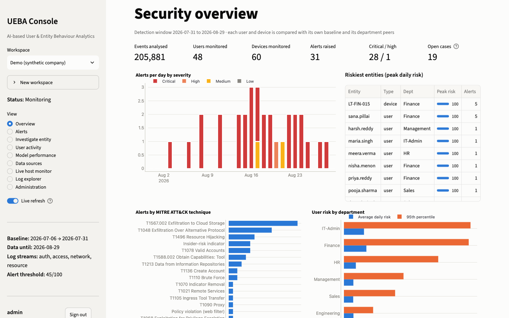
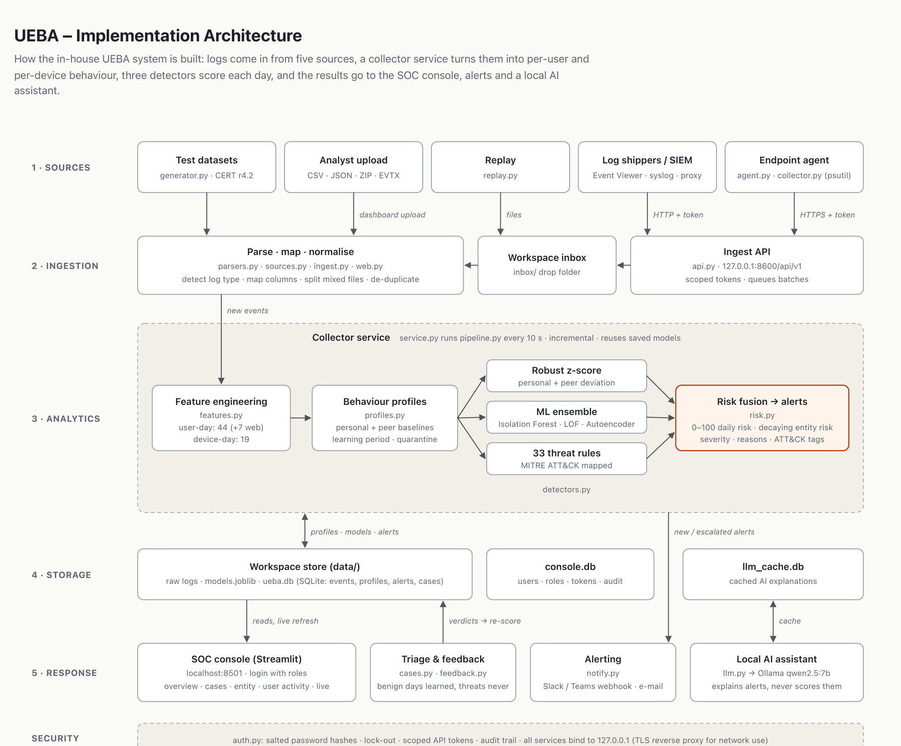
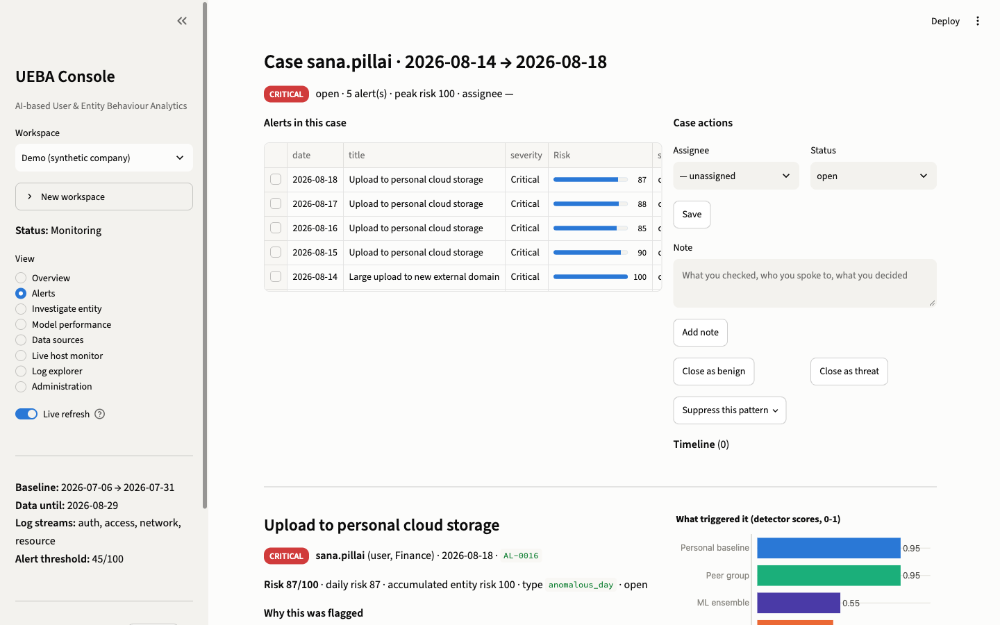
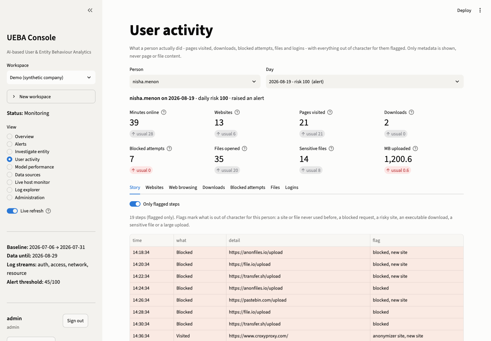

# UEBA: User and Entity Behaviour Analytics for Insider Threat Detection

In-house project, B.Tech CSE (Cyber Security), Alliance University
**Amaan Saify** (2023BCSE07AED025) · Guide: **Dr. Rathnakar Achary**

A Python system that reads authentication, system-access, network, web-proxy and resource-usage logs,
learns how each user and device normally behaves, and raises risk-scored alerts when someone starts
acting out of character. It comes with a SOC console for triaging those alerts.



## Documents

| | |
|---|---|
| Project report | [PDF](docs/report/UEBA_Project_Report.pdf) · [DOCX](docs/report/UEBA_Project_Report.docx) |
| Review paper: *A Review of UEBA for Insider Threat Detection: Detection Models, Evaluation Practice and the SOC* (Amaan Saify, Tarun S Jhadav) | [PDF](docs/review_paper/UEBA_Review_Paper.pdf) · [DOCX](docs/review_paper/UEBA_Review_Paper.docx) |
| Implementation architecture | [PNG](docs/architecture.png) · [PDF](docs/architecture.pdf) |
| Presentation | [PDF](docs/presentation/UEBA_Presentation.pdf) · [PPTX](docs/presentation/UEBA_Presentation.pptx) |
| Report diagrams (DFDs, flowchart, use case) | [docs/report/diagrams](docs/report/diagrams) |

## Architecture



Logs arrive from five kinds of source and are parsed, mapped to one schema and de-duplicated. A
collector service turns them into per-user and per-device daily features, compares each day with
that entity's own history and with its department peers, and scores it with three detectors:

- **Robust z-scores** against the personal and peer baselines
- **ML ensemble** of Isolation Forest, Local Outlier Factor and an autoencoder, trained only on normal days
- **33 threat rules** mapped to MITRE ATT&CK (brute force, impossible travel, exfiltration to cloud storage,
  lateral movement, privilege escalation, web-filter bypass, DNS tunnelling, beaconing, suspicious PowerShell, ...)

The scores are fused into a 0-100 daily risk. A decaying entity risk catches slow insiders who never
have one loud day. Every alert lists its reasons in plain language along with its ATT&CK tags.
Analyst verdicts feed back into the baseline: days marked benign are learned, confirmed threats never are.

## Features

- **Bring your own logs:** CSV, JSON, ZIP, Linux `auth.log`/syslog, Windows Event Viewer CSV,
  PowerShell exports, raw `.evtx` (Security, Sysmon, PowerShell, PrintService), Squid and web-gateway logs.
  The log type and column mapping are detected automatically.
- **Workspaces** with a learning → monitoring lifecycle, one per monitored environment.
- **Continuous operation:** drop folder, token-protected HTTP ingest API and an endpoint agent (psutil).
  Scoring is incremental: models are trained once and only new days are scored.
- **SOC console** (Streamlit): overview, cases and alert triage, entity investigation, user activity
  (sites and subdomains visited, time on each, downloads, blocked requests, files opened), live monitor,
  log explorer, model performance and administration.
- **Notifications** by webhook (Slack / Teams / Discord) or e-mail, sent once and again on escalation.
- **Console security:** roles (viewer / analyst / admin), PBKDF2 password hashing, lock-out,
  scoped API tokens and an audit trail. Everything binds to localhost by default.
- **Optional local AI assistant** (Ollama, `qwen2.5:7b`) that summarises cases and explains PowerShell
  commands. It never scores alerts, and no log data leaves the machine.

| Alert triage | User activity |
|---|---|
|  |  |

## Results

**Synthetic company** (48 people, 12 servers, ~205k events over 60 days, 12 planted attacks plus
4 harmless oddities that look suspicious):

| Metric | Value |
|---|---|
| Incidents detected | 12 / 12, all on the first day |
| Precision / Recall / F1 | 0.935 / 0.967 / 0.951 |
| False-positive rate | 0.09 % of normal entity-days |
| ROC-AUC / PR-AUC | 1.000 / 0.998 |

Over 5 different simulated companies the mean F1 is 0.942. Full tables, including the ablation study,
are in [reports/experiments.md](reports/experiments.md).

**CMU CERT r4.2** (1,000 users, 17 months, 70 insiders; held-out half of the users):

| | Out of the box | + R16 (first-time USB use) |
|---|---|---|
| Insiders alerted on a malicious day | 3 / 36 | 22 / 36 |
| Insiders among the 3 riskiest users per day | 12 / 36 | 28 / 36 |
| Alerts per day (~500 users) | 0.66 | 0.84 |

Quiet insiders who steal data gradually (CERT scenario 2) are still mostly missed. A 7-day trend layer
was tested for them and not adopted ([reports/cert_trend_layer.md](reports/cert_trend_layer.md)).
Details are in [reports/cert_r4.2.md](reports/cert_r4.2.md).

## Running it

Requires Python 3.10+.

```bash
python3 -m venv .venv
source .venv/bin/activate        # Windows: .venv\Scripts\activate
pip install -r requirements.txt

python run_pipeline.py           # generate the demo company and analyse it
python launch.py                 # collector service + ingest API + console
```

Open <http://localhost:8501>. On first start you create the admin account.

To watch attacks being caught live, create a workspace in the console (sidebar → New workspace)
and replay a dataset into it:

```bash
python -m ueba.replay --workspace live-demo --labels
```

To try real-looking logs, upload the files in [`sample_logs/`](sample_logs) (Windows Security CSV and Linux `auth.log`).

| Command | Purpose |
|---|---|
| `python run_pipeline.py --seed 7` | simulate a different company |
| `python run_pipeline.py --logs my_logs/` | one-off analysis of a folder of logs |
| `python run_pipeline.py --cert data/cert/r4.2` | run on CERT r4.2 (download from [KiltHub](https://kilthub.cmu.edu/articles/dataset/Insider_Threat_Test_Dataset/12841247)) |
| `python -m ueba.agent --url http://127.0.0.1:8600 --workspace lab --token ...` | stream a machine's telemetry |
| `python experiments.py` | robustness and ablation study |
| `python experiments_cert.py` | CERT benchmark |
| `python -m pytest -q` | test suite (44 tests) |

## Project layout

```
ueba/            detection engine: parsing, features, profiles, detectors, risk, service, API, agent, auth
dashboard/       Streamlit SOC console (one module per page in views/)
tests/           pytest suite
reports/         evaluation results, experiment tables and figures
sample_logs/     example Windows and Linux logs to upload
docs/            report, review paper, architecture, presentation, screenshots
run_pipeline.py  command-line analysis
launch.py        start everything
```

## Limitations and future work

- Behavioural layers barely separate quiet insiders on CERT (ROC-AUC about 0.54). Sequence-aware models are the next step.
- Features are computed per day, so detection within a day would need per-event streaming.
- SQLite suits one organisation of a few hundred users. Larger deployments would need PostgreSQL or a columnar store.
- No automated response (disabling accounts, isolating hosts) yet.

## Tech stack

Python · pandas · NumPy · scikit-learn · SQLite · Streamlit · Plotly · Matplotlib · psutil · pytest · Ollama (optional)
