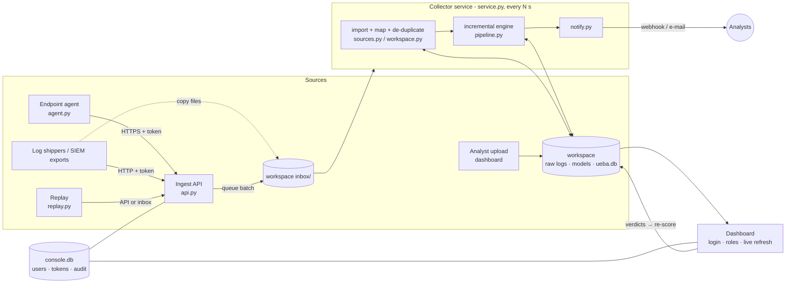
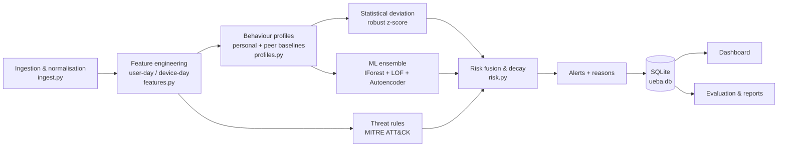

# AI-Based User and Entity Behaviour Analytics (UEBA) System

**In-house project** · Amaan Saify (2023BCSE07AED025) · B.Tech CSE (Cyber Security), Alliance University
**Coordinator:** Dr. Rathnakar Achary

> *Develop a Python-based UEBA system that captures authentication, system-access, network and
> resource-usage logs, builds behavioural profiles for users and devices, identifies deviations from
> normal behaviour, and generates risk-based security alerts.*

---

## 1. Quick start (macOS / Linux / Windows)

Requires **Python 3.10+**.

```bash
cd "InHouse Project"
python3 -m venv .venv
source .venv/bin/activate            # Windows: .venv\Scripts\activate
pip install -r requirements.txt

python run_pipeline.py               # build the demo: generate logs -> profile -> detect -> alert -> evaluate
python launch.py                     # start the system: collector service + ingest API + dashboard
```

Open <http://localhost:8501>. On first start you create the **administrator account**; the
**Demo** workspace (a simulated 48-person company with 11 planted attacks) is already analysed.

**Watch it catch attacks live** (best demo): in the dashboard create a workspace (sidebar →
New workspace, e.g. "Live demo"), then in a second terminal

```bash
python -m ueba.replay --workspace live-demo --labels
```

30 days of history are sent at once (the learning period), then one day every 20 s. The collector
service imports, scores and alerts on each slice; the dashboard refreshes by itself, and if a webhook
is configured (Data sources → Notifications) a message arrives as each attack starts.

Other commands:

| Command | What it does |
|---|---|
| `python run_pipeline.py --skip-generate` | re-run the analytics on the existing demo logs in `data/raw/` |
| `python run_pipeline.py --seed 7` | simulate a different company (different people, habits, victims) |
| `python run_pipeline.py --threshold 50` | change the alert threshold |
| `python run_pipeline.py --logs my_logs/` | one-off analysis of a folder of logs (CSV/JSONL, canonical columns) |
| `python run_pipeline.py --workspace "Lab" [--retrain]` | analyse new data in a dashboard workspace (incremental) |
| `python run_pipeline.py --cert data/cert/r4.2` | run on the **CMU CERT Insider Threat** benchmark (own workspace "CERT r4.2") |
| `python -m ueba.service --api` | collector service on its own (inbox watcher, scoring, notifications, ingest API) |
| `python -m ueba.agent --url http://127.0.0.1:8600 --workspace lab --token …` | stream a machine's telemetry to the API |
| `python -m ueba.replay --workspace NAME [--url … --token …]` | replay a dataset as a live feed |
| `python experiments.py` | robustness (5 seeds) + ablation study → `reports/experiments.md` |
| `python -m pytest -q` | 35 unit + integration tests |
| `python experiments_cert.py` | CERT r4.2 benchmark, both variants + held-out split → `reports/cert_r4.2.md` |

---

## 2. How the problem statement is covered

| Requirement | Where | How |
|---|---|---|
| **Capture** authentication logs | `ueba/generator.py`, `ueba/ingest.py` | interactive, VPN, SSH, RDP, Kerberos logins with source IP, device and geo-location |
| **Capture** system-access logs | same | file / application / privileged-command access with data-sensitivity labels |
| **Capture** network and web logs | same + `ueba/web.py` | outbound connections (domain, port, bytes in/out) and, from a web proxy / gateway, the page and subdomain visited (erp.ibm.com under ibm.com), site category, allowed or blocked, downloaded files and estimated time spent per website |
| **Capture** resource-usage logs | same + `ueba/collector.py` | hourly CPU / memory / disk / process samples; **live capture from the real host** via psutil |
| **Behavioural profiles** for users *and* devices | `ueba/features.py`, `ueba/profiles.py` | 44 user features (+7 web-activity features when proxy logs are present) and 19 device features per day; personal baseline, department peer baseline, usual hours, hosts, countries, domains |
| **Identify deviations** | `ueba/detectors.py` | robust z-scores (personal + peer), ML ensemble (Isolation Forest, LOF, Autoencoder), 28 MITRE-mapped threat rules (incl. web-filter bypass, tool downloads, random-subdomain tunnelling and clockwork beaconing) |
| **Risk-based alerts** | `ueba/risk.py` | fused 0-100 daily risk, decaying accumulated entity risk, severity, plain-English reasons, MITRE ATT&CK tags |
| Presentation | `dashboard/` | Streamlit SOC console: overview, cases & alert triage, entity investigation, **user activity** (what a person browsed - websites, subdomains and minutes on each - downloaded, was blocked from and opened, with the out-of-character steps flagged), model performance, data sources, live monitor, log explorer, administration; refreshes live |
| Analyst workflow | `ueba/cases.py` | alerts grouped into cases (status, assignee, notes); suppression of known-benign patterns with expiry and reason; CSV export |
| Bring your own logs | `ueba/sources.py`, `ueba/workspace.py` | upload CSV/JSON/ZIP exports, automatic log-type detection and column mapping, per-dataset workspaces with a learning → monitoring lifecycle |
| Continuous operation | `ueba/service.py`, `ueba/api.py`, `ueba/agent.py` | drop-folder + HTTP ingest API + endpoint agent; incremental scoring with saved models; runs unattended |
| Alerting people | `ueba/notify.py` | webhook (Slack/Teams/Discord) and e-mail on new or escalated alerts, de-duplicated |
| Securing the tool itself | `ueba/auth.py` | accounts with roles, salted password hashes, lock-out, scoped API tokens, audit trail |
| Analyst feedback loop | `ueba/feedback.py`, dashboard | "Mark benign" / "Confirm threat" on every alert; benign days are learned into the entity's baseline at the next run, confirmed threats are never learned |
| Validation | `ueba/evaluate.py`, `experiments.py` | ground-truth evaluation, ROC/PR curves, incident detection, robustness over seeds, ablation |

---

## 3. Architecture

### System (how it runs)



### Analytics pipeline (what happens to the data)



### 3.1 Data (synthetic enterprise + CERT)

`ueba/generator.py` simulates a 48-person company (Engineering, Finance, HR, Sales, IT-Admin,
Management), each person with their own laptop, working hours, remote/office location, servers,
files and websites, plus 12 servers - **~205,000 events over 60 days**.

* Days 1-30: attack-free **baseline** (days 1-5 are warm-up).
* Days 31-60: **detection window** with 11 planted incidents (17 user-days + 11 device-days labelled)
  and 4 *benign* oddities that look suspicious but are not attacks (late-night deadline, business
  trip to Singapore, 20 GB backup, joining a new project) - these create realistic false-positive pressure.

| ID | Scenario | MITRE ATT&CK |
|---|---|---|
| INC-01 | Brute-force from Tor exit node, then success + data pulled | T1110 |
| INC-02 | Impossible travel (Bengaluru → Amsterdam in 70 min) | T1078 |
| INC-03 | 02:20 login, payroll read, WeTransfer upload | T1078 |
| INC-04 | 3.3 GB exfiltration to mega.nz + API keys read | T1567 |
| INC-05 | 5-day slow insider exfiltration to Dropbox + job-site visits | T1567.002 |
| INC-06 | Sales user escalates privileges on domain controller | T1068 |
| INC-07 | Lateral movement: SSH/RDP into 12 new hosts | T1021 |
| INC-08 | 3-day cryptomining on a laptop | T1496 |
| INC-09 | Password spray on an admin (no success) | T1110 |
| INC-10 | Impossible travel (Lagos) + 1.2 GB upload | T1078 / T1567 |
| INC-11 | Admin account abuse: new AD accounts, security log cleared | T1136 / T1070 |
| INC-12 | Web-filter evasion: blocked 7 times on file-sharing sites, switches to a web proxy, downloads nmap and mimikatz, uploads 1.2 GB through the proxy | T1090 / T1105 |

**CERT Insider Threat dataset** (CMU SEI, the public benchmark used in UEBA research; 1,000 simulated
employees over 17 months, 70 malicious insiders in three scenarios). Download `r4.2.tar.bz2` (4.8 GB,
~16 GB unpacked) and `answers.tar.bz2` from
<https://kilthub.cmu.edu/articles/dataset/Insider_Threat_Test_Dataset/12841247>, unpack both into
`data/cert/`, move `answers/` inside `r4.2/`, then run `python run_pipeline.py --cert data/cert/r4.2`.
The adapter maps logon → auth, device/file → access (USB), http/email → network; streams the
multi-GB files in chunks (HTTP page views are collapsed to one row per user, PC, day and domain, which is
what the features use); reads every monthly LDAP snapshot so leavers keep their department; and labels
only this release's malicious days. The result goes into its own workspace **CERT r4.2** with the
attack-free months (Jan-May 2010) as the learning period, so the demo results are untouched. CERT has no
resource-usage stream, so those features stay at zero.

### 3.2 Behavioural features (per entity per day)

* **Authentication** - logins, failures, max failures in 10 min, failure-burst-then-success, new source
  IPs, new hosts, SSH/RDP sessions, logins from unregistered devices, logins at hours that are rare
  *for that user*, new countries, impossible-travel hops (haversine distance / time > 900 km/h).
* **System access** - accesses, confidential/restricted accesses, privilege escalations, deletions,
  never-seen resources, off-hours accesses, account creation, log clearing, USB events.
* **Network** - connections, MB up/down, largest upload, new domains, MB to *new* external domains,
  MB to cloud storage, new ports, mining-pool connections, job-site visits, internal hosts contacted.
* **Resource usage** - average/peak CPU, hours above 85% CPU, memory, disk I/O, active hours.

"New" and "unusual-hour" features are computed **causally** (only against earlier days), exactly as a
live system would see them.

### 3.3 Profiles and deviation

For every entity: **median** and a robust **scale** = max(1.4826 × MAD, (P95 − median)/1.645, floor).
The P95 term respects each person's own occasional peaks (e.g. a monthly 60 MB deck upload), which
removed most false positives. Deviations are robust z-scores, compared both with the entity's own
history and with its **department peers**.

**Adaptive baseline** - during detection, each day is compared with that entity's last 45 *accepted*
days, so profiles keep learning legitimate change. Days with risk ≥ 60 or any threat-rule hit are
**quarantined** from learning, so an attacker cannot slowly teach the model to accept the attack.

### 3.4 Machine learning ensemble

Trained only on baseline behaviour (unsupervised - no attack labels are used for training):

* **Isolation Forest** - isolates rare points with random splits.
* **Local Outlier Factor** (novelty mode) - compares local density with neighbours.
* **Autoencoder** (MLP 44→16→6→16→44) - learns to reconstruct normal days; high reconstruction error = abnormal.

Each score is calibrated against its own baseline distribution (1.0 = 99th percentile of normal) and
the three are averaged.

### 3.5 Risk scoring & alerts

```
A          = 1 − (1 − 0.28·stat)(1 − 0.10·peer)(1 − 0.30·ml)(1 − rules)
daily_risk = 100 · min(1, A × criticality)          criticality: admin/server 1.3, finance/mgmt 1.2, HR 1.1
entity_risk_t = entity_risk_(t−1) · 0.5^(days/3) + max(0, daily_risk − 15)     (capped at 100)
```

* **anomalous_day** alert when daily risk ≥ **45**. The threshold is set so that the two baseline layers
  on their own (max 43.8) cannot alert - an alert needs corroboration from the ML ensemble or a threat rule.
* **sustained_risk** alert when accumulated risk ≥ 60 without a recent alert (catches slow insiders).
* Severity: ≥ 80 critical, ≥ 60 high, ≥ 45 medium. Every alert lists its reasons in plain English,
  e.g. *"3,300 MB uploaded vs usual 1.2 (2750x usual) - also unusual vs peers"*.

---

### 3.6 Running it as a system

**Workspaces.** Each monitored environment is a workspace with its own logs, profiles, models,
alerts and analyst verdicts (`data/workspaces/<id>/`); the synthetic company is the read-only
**Demo** workspace. Lifecycle: *No data* → *New data* → **Learning** (fewer days than the learning
period, default 30, min 7 - profiles are built, no alerts) → **Monitoring**.

**Four ways in, one code path.** Every route ends in the same import step (stream detection, column
mapping, value normalisation, de-duplicated append):

| Route | For | How |
|---|---|---|
| Upload | one-off exports | Data sources → Add logs: auto-detects the log type and maps columns (`TimeCreated` → timestamp, `TargetUserName` → user, `cs_bytes` → bytes_out …), preview before import, mapping remembered for files with the same columns |
| Text and Windows logs | Linux / Windows | Linux `auth.log` / syslog text, Windows Event Viewer CSV, PowerShell exports and raw `.evtx` are read directly; a file mixing several event types is split by its event-type column |
| Web proxy logs | Squid / gateways | Squid `access.log` and web-gateway CSV exports (Zscaler-style columns): full URL, site category, allowed / blocked (TCP_DENIED, 403, Blocked), downloads; categories fall back to a built-in list of well-known sites |
| Drop folder | export jobs, `rsync`, SIEM forwarders | copy files into `data/workspaces/<id>/inbox/`; `auth__x.csv` forces the stream; bad files go to `inbox/failed/` with an `.error.txt` |
| Ingest API | agents, scripts, log shippers | `POST /api/v1/workspaces/<id>/ingest/<stream>` with `Authorization: Bearer <token>`; JSON, JSON-lines or CSV; returns `202` and queues the batch in the inbox |
| Endpoint agent | machines | `python -m ueba.agent …` sends CPU, memory, disk, processes and connections every 15 s; keeps data and retries while the server is unreachable |

Values are normalised on the way in (`Logon Failure`/`4625` → failure, `CORP\alice` → alice, epoch
timestamps, CPU as 0-1, URLs → host names). Partial data is fine: with only authentication logs the
other streams' features stay at zero; without a user directory everyone is one peer group; without an
asset inventory every device seen counts as registered.

**Incremental engine (train once, score new data).** The first analysis after the learning period
trains the baselines and the ML ensemble and saves them (`models.joblib`, with a fingerprint of the
settings and learning window). Later analyses reuse them: previously scored days keep their scores
and accept/quarantine decisions, and only days from the earliest changed day onwards are scored
(the last day is always re-scored because it may have been partial). Because every feature is
causal this is **exactly equal to a full re-run** - verified by a test at a day boundary and mid-day -
while taking ~3 s instead of re-training. A full re-train happens automatically when it must (settings,
learning period, user directory or asset inventory changed; models trained before the learning period
was complete) and on demand (*Re-train models*). An analyst verdict on day D marks D onwards for
re-scoring, so a *benign* day is learned into the baseline for the following days.

**Collector service.** `python -m ueba.service --api` (started by `launch.py`) loops every 10 s:
import the inbox → incremental analysis if anything changed → notify. One broken file or workspace
never stops the others; a heartbeat (`data/service.json`) lets the dashboard show whether it is alive.
Workspace changes run under a file lock so the dashboard and the service can't corrupt each other.

**Notifications.** Per workspace: webhook URL (Slack / Teams / Discord / any JSON endpoint) and/or
e-mail (SMTP via `UEBA_SMTP_HOST`, `_PORT`, `_USER`, `_PASSWORD`, `_FROM`), minimum severity. Each
alert is sent once and again only if it escalates; closed alerts and back-filled history (> 7 days
older than the newest data) stay quiet; every attempt, including failures, is logged.

**Security of the console.**

* Accounts with roles - **viewer** (read-only), **analyst** (+ alert verdicts), **admin** (+ data,
  analysis, settings, users, tokens); the first start creates the admin.
* Passwords: PBKDF2-HMAC-SHA256 (310k iterations, per-user salt), constant-time comparison, generic
  error messages, 5 failures → 15-minute lock-out, 8-hour sessions.
* API tokens: 256-bit random, shown once, stored as SHA-256, scoped to one workspace, revocable.
* Audit trail of logins (incl. failures), verdicts, uploads, analyses, settings, users and tokens
  (Administration → Audit log, CSV export).
* Dashboard and API listen on **localhost only** by default (see Deployment).

---

## 4. Results (seed 42, detection window)

| Metric | Value |
|---|---|
| Incidents detected | **12 / 12** (all on the day they started) |
| Precision / Recall / F1 | **0.935 / 0.967 / 0.951** |
| False-positive rate | 0.09 % of normal entity-days (2 false alerts in 30 days) |
| Alerts per day | ~1.0 for 108 monitored entities |
| Fused ROC-AUC / PR-AUC | 1.000 / 0.998 |

**Robustness over 5 different simulated companies:** mean precision 0.923, recall 0.967, F1 0.945,
12/12 incidents detected every time (`reports/experiments.md`).

**Ablation (what each layer adds, mean of 5 seeds):**

| Variant | PR-AUC | F1 |
|---|---|---|
| Full system | 0.996 | 0.945 |
| Behaviour only (no rules) | 0.953 | 0.854 |
| ML ensemble only | 0.917 | 0.856 |
| Personal baseline only | 0.487 | 0.468 |
| Threat rules only | 0.967 | 0.983 |

**Honest interpretation (synthetic):** rules score very high because they were written for these known attack
types. The value of the behavioural/ML layers is that they need **no prior knowledge of the attack** -
with rules switched off, the system still reaches F1 0.85, and the ML ensemble alone improved from F1 0.79 to
0.86 once web activity was profiled. Combining them gives the best ranking (PR-AUC 0.996). The two false
positives are planted benign oddities (a 20 GB backup, and an HR user joining a new project and opening 11
unfamiliar files) - genuinely unusual behaviour that an analyst would close in seconds. Synthetic data is cleaner than real logs, so the CERT run is the more realistic benchmark.

### 4.1 CERT r4.2 benchmark (independent data)

The synthetic organisation was designed together with the detector, so the system was also run on the
public **CMU CERT r4.2** insider-threat data set (1,000 users, 17 months, 70 insiders, 12.8 M events after
conversion; ~8 min, 6.4 GB peak memory). Protocol (`experiments_cert.py`): unsupervised, learning period
Jan-May 2010 (before any attack); users split at random into a development half and a **held-out test
half**; the out-of-the-box result is frozen first.

| Held-out test half (36 labelled accounts) | Out-of-the-box | + R16 (generic USB indicator) |
|---|---|---|
| Insiders alerted on a malicious day | **3 / 36** | **22 / 36** |
| · scenario 1 - new USB user leaks data | 1 / 18 | 18 / 18 |
| · scenario 2 - job seeker steals data | 1 / 14 | 1 / 14 |
| · scenario 3 - admin plants keylogger | 1 / 4 | 3 / 4 |
| Alerts per day (~500 users) | 0.66 | 0.84 |
| Day-level precision / recall | 0.017 / 0.008 | 0.146 / 0.091 |
| Fused ROC-AUC | 0.699 | 0.733 |
| Insiders among the 3 riskiest users per day | 12 / 36 | 28 / 36 |

**What it shows.** Out of the box the system generalises poorly: its behavioural layers were calibrated on
loud synthetic attacks and ignore deviations below 3 robust σ / the 99th ML percentile, which is exactly
where quiet CERT insiders sit (statistical and ML layers rank CERT days at ROC-AUC ≈ 0.54). One generic
insider indicator - removable-media use by an account with no removable-media history (R16, T1052.001),
chosen on the development half (4 → 17 / 36) and never firing on the synthetic data - lifts the held-out
result to 22 / 36 at under one alert a day. Gradual theft by job seekers (scenario 2), who already used
USB drives, remains largely undetected. A 7-day trend layer was tried for them (`experiments_trend.py`,
`reports/cert_trend_layer.md`): it raises ROC-AUC by ~0.1 but either catches no extra insider at a usable
alert rate or multiplies alerts ~11x, and it worsens the top-k analyst budget, so it was **not adopted** -
gradual insiders need sequence-aware models (future work). The answer key labels 72 accounts: 70 insiders + 2 supervisors whose accounts
scenario-3 insiders misused. Full tables: `reports/cert_r4.2.md`; figure `reports/figures/cert_r4.2.png`.

Figures for the report are generated in `reports/figures/`: ROC curves, PR curves, risk distribution,
confusion matrix, per-detector AUC, peak risk per incident.

---

## 5. Project structure

```
InHouse Project/
├── launch.py                # start everything: collector service + ingest API + dashboard
├── run_pipeline.py          # CLI: demo / folder / CERT / workspace analysis
├── experiments.py           # robustness + ablation
├── ueba/
│   ├── config.py            # every tunable parameter, documented
│   ├── generator.py         # synthetic enterprise logs + planted attacks + ground truth
│   ├── ingest.py            # load / validate / normalise logs, unified event schema, SQLite
│   ├── features.py          # user-day & device-day behavioural features
│   ├── profiles.py          # personal & peer baselines, descriptive profiles
│   ├── detectors.py         # statistical, ML ensemble, MITRE-mapped rules, explanations
│   ├── risk.py              # risk fusion, decay, alert generation
│   ├── pipeline.py          # orchestration: full training run or incremental update
│   ├── evaluate.py          # metrics, incident detection, figures, markdown report
│   ├── sources.py           # incoming files: stream detection, column mapping, value normalisation
│   ├── workspace.py         # workspaces, inbox, locking, learning -> monitoring lifecycle
│   ├── service.py           # collector service (inbox -> incremental analysis -> notifications)
│   ├── api.py               # ingest API (stdlib HTTP server, token auth)
│   ├── agent.py             # endpoint agent (psutil telemetry, store-and-forward)
│   ├── replay.py            # replay a dataset as a live feed
│   ├── notify.py            # webhook / e-mail notifications, de-duplication
│   ├── auth.py              # users, roles, password hashing, API tokens, audit log
│   ├── feedback.py          # analyst verdicts (benign / threat) fed back into baselines
│   ├── cert_loader.py       # CMU CERT insider-threat dataset adapter
│   └── collector.py         # host telemetry sampling (psutil)
├── dashboard/
│   ├── app.py               # shell: sign-in, workspace, status, navigation, live refresh
│   ├── ui.py                # per-session context, cached queries, permissions, chart styling
│   └── views/               # one module per page (overview, alerts, entity, performance,
│                            #   sources, live, logs, admin, login)
├── tests/                   # pytest: detection, ingestion, platform (engine, API, auth, service)
├── data/                    # demo logs + results; workspaces/; console.db (users, tokens, audit)
└── reports/                 # evaluation.md/json, experiments.md, figures/*.png (generated)
```

## 6. Testing

`python -m pytest -q` - 35 tests, ~55 s:

* **Detection** - haversine / impossible travel, hour rarity, deviation scoring, rules, risk fusion
  bounds, full pipeline catches the planted attacks with FPR < 2 %, no attacks in the baseline window,
  CERT adapter, feedback round-trip.
* **Ingestion** - foreign column names and values (`TimeCreated`, `CORP\Alice`, `4625`), partial streams.
* **CERT** - adapter on a format-identical sample; answers of other releases never label users; R16 and
  the rule-disable switch.
* **Workflow** - cases group alerts and closing records verdicts; suppressions hide but keep alerts; a
  threshold change needs no re-training; users change their own password.
* **Platform** - incremental update **equals** a full re-run (day boundary and mid-day); re-training
  is forced when models can't be reused; inbox import and rejection reasons; ingest API auth / scope /
  validation / queueing; password hashing, roles, lock-out, token scoping and revocation, audit;
  notification de-duplication, escalation, back-fill suppression and failure logging; a service pass
  that learns, then detects and notifies.

## 7. Deployment

* `python launch.py` runs everything on one machine. For an always-on install run
  `python -m ueba.service --api` and `streamlit run dashboard/app.py` as services (systemd / launchd /
  NSSM on Windows).
* Both listen on localhost. To serve a team or remote agents, put them behind a reverse proxy with TLS
  (nginx / Caddy) - agents then use `https://…`; don't expose the plain HTTP ports.
* Back up `data/` (logs, models, verdicts, users). `data/console.db` holds password hashes and token
  hashes only.

## 8. Tech stack

Python · pandas · NumPy · scikit-learn · SQLite · Streamlit · Plotly · Matplotlib · psutil · pytest
(the service, API, agent and notifications use only the standard library).

**On-the-spot datasets:** see `docs/PANEL_DATA_PLAYBOOK.md` and the practice packs built by `python docs/data/make_rehearsal.py`.

## 9. Limitations & future work

* **Quiet insiders.** On CERT r4.2 the behavioural layers barely separate malicious from normal days
  (ROC-AUC ≈ 0.54) because they ignore small deviations; continuous, per-organisation calibrated scores
  are needed to catch gradual insiders (CERT scenario 2). Precision on the synthetic data (0.935) is an
  upper bound.
* **More validation.** CERT r5.2 / r6.2 and real Windows Event / Sysmon / Zeek logs (which can be
  uploaded or shipped to the API today).
* The agent can't measure bytes per connection without packet capture, so upload volumes and web pages
  should come from proxy / firewall logs (Squid and gateway CSV exports are read directly). HTTPS pages are
  only visible where the proxy inspects TLS; otherwise only the site is known.
* Daily granularity: an attack is detected within one service pass of its data arriving, but features
  are per day; per-event streaming scoring (e.g. Kafka) would add intra-day sequence detection.
* SQLite and CSV storage suit one organisation of hundreds of users; larger deployments would move to
  PostgreSQL / a columnar store, and parse native formats (EVTX, syslog) directly.
* Automated response (disable account, isolate host via SOAR) would complete the SOC loop.
* Graph-based features (user-host access graph) could strengthen lateral-movement detection.
